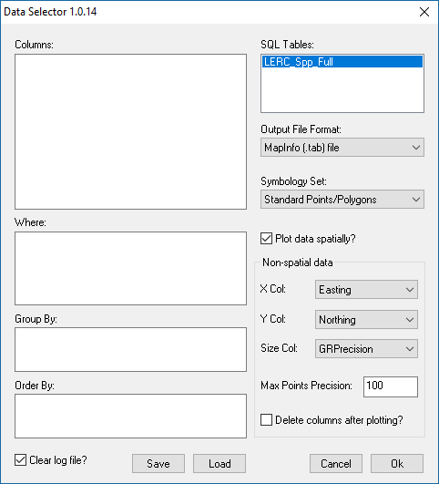

****************
Running the tool
****************

Use :doc:`../quickstart/quickstart` for a routine run. This chapter explains
the controls in DataSelector for MapInfo version |release| in more detail.
An administrator must first complete :doc:`../setup/setup`.

.. index::
   pair: Profiles; choosing
   pair: Form; opening
   single: SQL Tables

Opening the form and choosing a table
=====================================

Launch the tool using the menu or ribbon button described under
:ref:`administrator_checklist` and shown in :numref:`figSelectorLaunch`.
Choose the appropriate XML profile if prompted. A single available profile
is selected automatically. The tool connects to SQL Server and lists the
tables returned by :ref:`setting_TableListSQL`.

Select one entry in **SQL Tables**. Double-click an entry to insert its
column names into **Columns**; if text is already present, confirm before
replacing it. The other SQL fields are not reset by this action.

.. _figSelectorForm:

   DataSelector form: query fields, source table and output options

.. index::
   pair: SQL; entering expressions
   pair: Queries; grouped results

Entering the query
==================

Enter the required attributes or expressions in **Columns**. Use ``*`` for
all columns, or list them explicitly to keep the output focused and avoid
unnecessary width. **Where**, **Group By** and **Order By** are optional.
Enter expressions without their SQL keywords. See :doc:`../sql/sql` for
filtering, aliases and summary examples.

If using existing SQL geometry, include its source column as required by
the database setup. If plotting coordinates, include the X, Y and grid-size
attributes under the names selected in the plotting controls. Include any
attributes referenced by the selected symbology set.

.. index::
   pair: Outputs; format reference
   pair: TAB; map display
   pair: SHP; translation
   pair: CSV; export
   pair: TXT; tab-separated export
   single: WindowsLatin1

.. _output_formats:

Output format reference
========================

Choose **Output File Format** before running the query. All formats first
download through a local TAB table and are subject to the same selection
checks. Only TAB output remains open in MapInfo after a normal run.

.. list-table::
   :header-rows: 1
   :widths: 16 32 26 26

   * - Format
     - Retained result
     - Geometry and styles
     - Display
   * - TAB
     - TAB and its companion files.
     - Existing or newly plotted geometry; optional configured symbology.
     - Mappable results go to a map; non-spatial results open in a browser.
   * - SHP
     - Shapefile components produced by Universal Translator.
     - Existing or newly plotted geometry. The configured TAB symbology
       routine is not applied.
     - Not automatically opened or mapped. The intermediate TAB is removed.
   * - CSV
     - Comma-separated attributes with column titles.
     - No plotted geometry or configured styling.
     - Not automatically opened. The intermediate TAB is removed.
   * - TXT
     - Tab-separated attributes with column titles, exported using
       WindowsLatin1.
     - No plotted geometry or configured styling.
     - Not automatically opened. The intermediate TAB is removed.

SHP requires MapInfo's Universal Translator installation under ``UT``;
the code invokes ``Fme.exe`` for MapInfo version 12 or later and ``Imut.exe``
for earlier versions. Test translation in the intended MapInfo installation,
particularly for mixed point/region results. Keep all translator-produced
components and check their attributes and feature counts.

.. index::
   pair: Symbology; choosing a set
   single: Symbology Set
   pair: Plotting; coordinates
   pair: Plotting; points and regions
   single: Max Points Precision
   single: Delete columns after plotting

.. _plotting:

Plotting and symbology
======================

For TAB output, choose **Symbology Set**, or **<None>** to leave the
configured styling unapplied. Rules run after plotting and require any
attributes used by their clauses. Only Point and Region style updates are
implemented. See :ref:`setting_MapInfoTables` for rule definitions.

For TAB or SHP output, the profile can expose **Plot data spatially?**.
When checked, choose **X Col**, **Y Col**, **Size Col** and **Max Points
Precision**. The tool plots all selected rows, replacing existing geometry
if present. When it is unchecked, existing recognised geometry can be
retained; no new objects are created from coordinates.

The tool uses the size value to align coordinates to a grid: X and Y are
reduced to the grid origin using ``Int(coordinate / size) * size``. A size
less than or equal to **Max Points Precision** produces a point at that
origin. A larger size produces a square extending one size unit in each
positive direction. Points are placed at the grid origin, not the square's
centre. For example, size 100 and threshold 100 produce a point; size 1,000
and threshold 100 produce a 1 km square when coordinates are in metres.

Use valid numeric coordinates and positive, non-zero sizes. The current
plotting routine divides by the size without validating each row. The
coordinate system must match the attributes; :ref:`setting_CoordinateSystem`
is used only when creating map geometry on a non-spatial table. Existing
mappable tables retain their coordinate system during re-plotting.

**Delete columns after plotting?** removes the chosen coordinate and size
attributes in the TAB branch, after symbology. It does not remove them from
SHP exports in the current code. Leave this unchecked unless a TAB result
without those attributes is intended. If you turn plotting off for a later
run, uncheck deletion first: the current code does not fully gate deletion
on whether plotting ran.

Missing required result columns cancel plotting and are reported in the log.
Changing the source table or loading a query does not guarantee the plotting
choices still match the result; check them before each run.

.. index::
   pair: Queries; running
   pair: Outputs; filenames
   pair: Outputs; overwriting
   pair: Form; keeping open

Running and checking the result
===============================

1. Check the source, all four SQL fields, format, plotting and symbology.
#. Choose whether to clear the previous log, then click **Ok**.
#. In the Save dialog, choose an existing output folder and a filename
   beginning with an ASCII letter A-Z or a-z, with the chosen extension.
   Use short names with letters, digits and underscores. The code replaces
   spaces and removes hyphens for its internal MapInfo alias.
#. Wait for processing, then answer **Do you wish to close the form?**.
   Choose **No** to retain the form for another selection, or **Yes** to
   close it.
#. Review the log opened in Notepad and inspect the actual output files.

.. caution::

   Reusing a destination can replace earlier output, including its working
   TAB files. CSV/TXT exports explicitly overwrite. Use a fresh basename
   if earlier results must be retained, including a basename that is not
   already used by an unrelated TAB table in the same folder.

For mappable TAB results, the tool adds a layer to the front window if it
is a map; otherwise it opens a new map. Non-spatial TAB results open in a
browser. Other formats are not added to the view.

The completion prompt and ``Process completed!`` message mean control has
returned from selection. They are not proof that an export succeeded:
zero-row selections, limit cancellations and some errors still reach them.
Read preceding messages, confirm the expected files exist, and compare
counts, attributes and geometry with the request.

Cancelling the output Save dialog cancels that selection and returns to
the form. The log may already have been cleared. The form's **Cancel**
button closes the form; it is not a documented stop-and-recover facility
for an active database query or translation.

.. index::
   pair: Limits; selected records
   pair: Limits; row width
   pair: Limits; total data size
   single: 4096 bytes

.. _selection_limits:

Selection limits
----------------

After the SQL procedure creates a subset, the tool cancels zero-row
results and results exceeding :ref:`setting_RecMax`. It then links an empty
table to estimate row width. Widths over 4,096 bytes are cancelled. A
further size estimate is intended to reject attribute data over 2 GB.

These are code checks, rather than a guarantee that a result below those
values will succeed. The size calculation estimates attribute data, rather
than the complete disk usage of all output components. Output-format,
driver, geometry and available-space constraints also apply. Reduce the
selected columns and divide very large queries into smaller selections.

.. index::
   pair: Queries; saving and loading
   pair: QSF files; contents
   single: Save
   single: Load

.. _saved_queries:

Saving and loading queries
===========================

Use **Save** to write the current four SQL fields to a ``.qsf`` file. Use
**Load** to restore them. The query folder must exist, and saving over a
QSF replaces it. A previously loaded query's name is offered when saving.

A QSF stores ``Fields``, ``Where``, ``Group By`` and ``Order By`` in a
simple text format. It does not store the profile, SQL table, format,
destination, plotting controls, symbology or log-clearing choice. Check
those after loading, especially when sharing queries between users or
databases. A QSF stores expressions, not a snapshot of the data; rerunning
it uses the prepared table as it exists at that time.

.. index::
   pair: Logs; review
   pair: Logs; clearing
   pair: Diagnostics; shapefile translation
   single: DataSelector log
   single: Universal Translator

.. _run_logs:

Run log and diagnostics
=======================

The tool appends timestamped messages directly to
``LogFilePath\DataSelector_<user>.log`` during processing. The Windows
username is used with spaces and full stops replaced by underscores.
The log is opened in Notepad after the close-form prompt is answered.
An already open Notepad window may need to reload the file to show changes.

**Clear log file?** deletes the previous file before the new run starts
and before the output destination is chosen. Leave it unchecked to append.
Profiles using the same log folder share the same user's log filename.
Keep a copy before a run if earlier diagnostics must be retained.

Check the selected table, format, output path, row count, estimated row
width/size, geometry messages, exports and any errors. This shortened
excerpt is illustrative; counts and intermediate messages depend on the data:

.. code-block:: text

   19/10/2026 10:00:00 : Process started!
   19/10/2026 10:00:00 : Table Name = 'Example_Spp'
   19/10/2026 10:00:00 : Output Format = '.tab'
   19/10/2026 10:00:01 : Output File = 'D:\DataSelector\Extracts\Birds_2020.tab'
   19/10/2026 10:00:02 : 12 records selected.
   19/10/2026 10:00:03 : Plotting local table ...
   19/10/2026 10:00:03 : Plotting 12 rows as points or polygons.
   19/10/2026 10:00:04 : Mapping table in map window ...
   19/10/2026 10:00:04 : Process completed!

For SHP problems, also inspect the subset-named ``.fme`` mapping file and
``<subset>_MUT.log`` in LogFilePath. A translation failure may still be
followed by the ordinary completion message and removal of the intermediate
TAB. Check the shapefiles themselves before accepting the result. Use TAB
output to retain a table for diagnosis or manual translation.

After an error or limit cancellation, a subset table or local temporary
files can remain. Keep the log and report the output name and time to the
administrator. Ask them to check ownership and active sessions before
removing database subsets or map-catalogue entries. Use a new output name
for a retry when existing results must be preserved.
