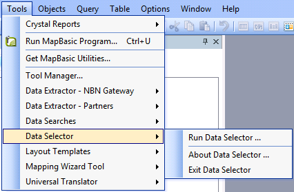

*******************
Setting up the tool
*******************

This chapter covers DataSelector for MapInfo version |release|. Prepare the
application, database connection and profiles before making the tool
available to routine users.

.. index::
   pair: Administrators; setup and upgrades
   pair: Upgrading; profiles
   single: Installation; validation

.. _administrator_checklist:

Administrator setup and upgrades
================================

1. **Back up the working installation.** Keep the MBX, icons,
   ``DataSelector.xml``, profiles, file DSNs and shared QSF queries. Record
   the MapInfo version and architecture used.
#. **Deploy matching files.** Use a compiled MBX appropriate to the intended
   MapInfo installation, together with the XML files and supporting icons.
   Editing MapBasic source does not update a compiled MBX.
#. **Check the database.** Test the file DSN with the account that runs
   MapInfo. Check source tables, the refresh date, schema, stored procedures,
   permissions and any spatial metadata; see :ref:`sql_database_setup`.
#. **Validate profiles and folders.** Check XML structure, source and column
   names, defaults and symbology. Create the extract and query folders and
   check users can create, replace and remove files. Check log-folder access.
#. **Run a representative test.** Use a separate output name and check the
   expected columns, counts and geometry. Test the formats users need,
   including the Universal Translator when SHP is required. Check complete
   file sets and the entire log, and test a saved query before sharing it.

.. _profile_migration:

Migrating older configurations
-------------------------------

Use the :ref:`current examples <example_xml>` as a reference. Preserve local
database rules and paths rather than replacing a working profile wholesale.

.. list-table::
   :header-rows: 1
   :widths: 33 67

   * - Older arrangement
     - Current arrangement
   * - One ``DataSelector.xml`` containing all settings
     - Keep ToolTitle and DefaultProfile in ``DataSelector.xml``. Put
       connection, output and symbology settings in a separate profile such
       as ``DefaultProfile.xml`` in the MBX folder.
   * - Assuming only one configuration is available
     - One profile is selected automatically. Multiple profiles display a
       chooser; set DefaultProfile to the preferred filename without ``.xml``.
   * - No DefaultClearLogFile setting
     - Set an explicit Yes or No to choose the initial **Clear log file?**
       state. A blank or missing value leaves it unchecked.
   * - Treating DefaultSpatialPlotting=No as disabling the option
     - No shows an unchecked plotting option. Leave the value blank to hide
       it; Yes shows and checks it.
   * - Assuming all object types support configured styles
     - The current style-update code handles Point and Region. Do not rely
       on a Line rule to apply a line style.

.. index::
   pair: MapInfo; installation
   single: MBX files
   single: Tool Manager
   single: AutoLoad
   single: Installation; architecture

Installing and loading
======================

The source checkout contains MBX builds named for MapInfo v11, v12 and v16.
Use the build appropriate to your installed MapInfo version and architecture;
these filenames are build targets, not a guarantee of compatibility with
every later version. Test the chosen application in your environment.

1. Place the MBX, ``DataSelector.xml``, profile XML files,
   ``DataSelector.png`` and ``btnDataSelector.png`` together in the tool folder.
#. Open MapInfo's tool-management window. In the classic interface use
   **Tools --> Tool Manager...**; ribbon controls vary by MapInfo version.
#. Use the add/browse controls to select and load the MBX. Supply a title
   and description if requested (:numref:`figSelectorLoad`).
#. Enable loading at startup if required. In the classic Tool Manager the
   checkboxes are **Loaded** and **AutoLoad**.

.. _figSelectorLoad:

.. figure:: figures/AddToolDialog.png
   :align: center

   Adding and loading the DataSelector application in MapInfo

.. index::
   single: Ribbon button
   single: Tools menu
   pair: MapInfo; launching DataSelector

Launching the tool
------------------

In the 64-bit ribbon build, the tool adds a button to the **Home** tab's
**Tools** group (:numref:`figSelectorLaunch`). In the classic interface use
**Tools --> Data Selector --> Run Data Selector**. The caption comes from
:ref:`setting_ToolTitle` and can differ between installations.

.. _figSelectorLaunch:

   Launching DataSelector from the Home tab's Tools group

You do not need to open any MapInfo source layers first. A workspace can
provide useful background mapping but does not determine which SQL tables
are listed in the tool.

.. index::
   single: File DSN
   single: ODBC
   pair: SQL Server; connection
   pair: SQL Server; stored procedures
   single: AFSelectSppSubset
   single: AFClearSppSubset
   single: Spatial_Tables
   single: MAPINFO_MAPCATALOG

.. _sql_database_setup:

Database connection and requirements
====================================

Configure an ODBC file DSN for the required SQL Server database using a
driver compatible with the MapInfo installation. Check access with the
same Windows or database identity that users will use. The database needs
prepared reporting tables or views and the following procedures in
:ref:`setting_DatabaseSchema`:

* ``AFSelectSppSubset`` creates the subset. The tool passes the schema,
  source table, Columns, Where, Group By, Order By, user suffix and a final
  numeric argument of ``0``, in that order.
* ``AFClearSppSubset`` clears it. The tool passes schema, source table and
  the same user suffix.

The account must be able to list/read the intended sources and execute
these procedures, with the permissions the procedures need to create and
remove subset tables and maintain spatial metadata. The exact permissions
depend on their installed definitions.

SQL scripts were moved out of this repository in November 2015. The current
checkout does not contain the deployed procedures, so obtain compatible
scripts from the database administrator. In particular, the historic
selection procedure is not sufficient evidence for today's parameter list.

For spatial results, verify the installation's ``Spatial_Tables`` metadata
and ``MAPINFO_MAPCATALOG`` handling. The historic Spatial_Tables definition
contains the following fields; confirm the current schema before changing it:

.. list-table:: Historic spatial metadata fields
   :header-rows: 1
   :widths: 30 70

   * - Field
     - Meaning
   * - TableName, OwnerName
     - Source table and schema/owner.
   * - XColumn, YColumn, SizeColumn
     - Coordinate and grid-size attributes used by the database scripts.
   * - IsSpatial, SpatialColumn
     - Whether the source has geometry, and its column name.
   * - SRID
     - Numeric SQL spatial-reference identifier.
   * - CoordSystem
     - MapInfo coordinate-system clause, stored as text.

An SRID number and a MapInfo ``Earth Projection ...`` clause are different
metadata values. Check each against the source data's coordinate system.

.. index::
   pair: Profiles; selection
   pair: XML; configuration files
   pair: XML; special characters
   single: DataSelector.xml
   single: DefaultProfile.xml

.. _configuration:

Configuration files and profile selection
=========================================

``DataSelector.xml`` is the main configuration file. Other XML files in
the MBX folder are offered as profiles, excluding that main file. With one
profile it is selected automatically; with several the user chooses one.
Keep unrelated XML and backup files with an ``.xml`` extension outside the
tool folder. Profiles are loaded from the application folder, so put them
beside the MBX.

Both files use this structure, with settings inside ``DataSelector``:

.. code-block:: xml

   <configuration>
     <DataSelector>
       <SettingName><value>Setting value</value></SettingName>
     </DataSelector>
   </configuration>

Keep element and attribute names, including ``value`` and ``Desc``, in the
case shown in the examples. Some option values are compared without regard
to case, but this does not make XML names interchangeable. Edit a backup in
a plain-text/XML editor and check that the resulting XML is well formed.

Within values, escape ``&`` as ``&amp;`` and ``<`` as ``&lt;``. Using ``&gt;``
for ``>`` is also recommended. For example, write
``RecYear &gt;= 2020 AND TaxonGroup = 'Birds'``. Do not put these XML escapes
into the SQL fields on the form.

The :ref:`appendix examples <example_xml>` are displayed from the same files
that users can download. Adapt their paths and data names before use.

.. index::
   pair: Configuration; main file

Main-file settings
------------------

.. _setting_ToolTitle:

.. index::
   single: ToolTitle
   pair: Tools menu; caption

ToolTitle
   Caption for the menu/button, for example ``Data Selector``. This is
   independent of the title entered in Tool Manager. The form itself uses
   the fixed title Data Selector and the program version.

.. _setting_DefaultProfile:

.. index::
   single: DefaultProfile
   pair: Profiles; default

DefaultProfile
   Preferred profile basename, for example ``DefaultProfile`` without
   ``.xml``. A blank value defaults to that basename when the main file is
   read successfully. It selects the initial choice when several profiles
   are available; it does not prevent the user choosing another profile.

.. index::
   pair: Configuration; connection and folders

Profile: connection and folders
-------------------------------

.. _setting_LogFilePath:

.. index::
   single: LogFilePath
   pair: Logs; folder

LogFilePath
   Folder for ``DataSelector_<user>.log`` and SHP translator diagnostics.
   The tool attempts to create a missing log folder. Check that the user
   can write to it; see :ref:`run_logs`.

.. _setting_FileDSN:

.. index::
   single: FileDSN
   pair: ODBC; file DSN

FileDSN
   Full path to the ODBC file DSN, such as
   ``D:\DataSelector\SQL Server\NBNData.dsn``.

.. _setting_DefaultExtractPath:

.. index::
   single: DefaultExtractPath
   pair: Outputs; default folder

DefaultExtractPath
   Initial folder in the output Save dialog. Users can choose another
   folder. The chosen folder must already exist.

.. _setting_DefaultQueryPath:

.. index::
   single: DefaultQueryPath
   pair: QSF files; default folder

DefaultQueryPath
   Initial folder for saving/loading QSF queries. The chosen folder must
   already exist.

.. _setting_DatabaseSchema:

.. index::
   single: DatabaseSchema
   pair: SQL Server; schema

DatabaseSchema
   Schema used for source tables, subsets and the two stored procedures,
   commonly ``dbo``. Use a single, consistent schema for the profile.

.. _setting_TableListSQL:

.. index::
   single: TableListSQL
   pair: SQL Tables; available sources

TableListSQL
   SQL Server query returning source table names in its first column.
   Return bare names, without a schema prefix. Filter by the configured
   schema as well as the required table pattern, and exclude subset tables.
   For example, ``LIKE 'Example[_]Spp'`` matches the exact example table
   while treating the underscore literally. A broader list must be adapted
   to the organisation's naming rules.

.. index::
   pair: Configuration; output defaults

Profile: output and form defaults
---------------------------------

.. _setting_DefaultFormat:

.. index::
   single: DefaultFormat
   pair: Outputs; default format

DefaultFormat
   ``tab``, ``shp``, ``csv`` or ``txt``. An unrecognised or blank value
   selects TAB. See :ref:`output_formats`.

.. _setting_RecMax:

.. index::
   single: RecMax
   pair: Limits; record count

RecMax
   Maximum selected row count allowed before downloading. A result greater
   than this value is cancelled rather than truncated. The subset is
   created in SQL Server before the count is checked. This does not replace
   the row-width and size checks described under :ref:`selection_limits`.

.. _setting_DefaultSymbologySet:

.. index::
   single: DefaultSymbologySet
   pair: Symbology; default set

DefaultSymbologySet
   ``0`` selects **<None>**; ``1`` selects the first configured set, ``2``
   the second, and so on. Sets follow their XML order. Applies to TAB
   output only.

.. _setting_DialogSize:

.. index::
   single: DialogSize
   pair: Form; size

DialogSize
   ``Max`` enlarges the form and SQL fields. Other values, conventionally
   ``Norm``, use the normal layout. Choose a size that fits the screen.

.. _setting_DefaultClearLogFile:

.. index::
   single: DefaultClearLogFile
   pair: Logs; clear default

DefaultClearLogFile
   ``Yes`` or ``Y`` checks **Clear log file?** initially. Other values,
   including blank or missing, leave it unchecked. Users can override the
   choice on the form. Clearing deletes the previous log before the output
   destination is requested; see :ref:`run_logs`.

.. index::
   pair: Configuration; spatial plotting

Profile: coordinate plotting
----------------------------

.. _setting_DefaultSpatialPlotting:

.. index::
   single: DefaultSpatialPlotting
   pair: Plotting; visible controls

DefaultSpatialPlotting
   ``Yes``/``Y`` shows and checks **Plot data spatially?**.
   ``No``/``N`` shows it unchecked. A blank or unrecognised value hides
   plotting controls. CSV/TXT runs do not plot, regardless of this default.

.. _setting_CoordinateSystem:

.. index::
   single: CoordinateSystem
   pair: Plotting; coordinate system

CoordinateSystem
   MapInfo coordinate-system clause used when adding geometry to a
   non-spatial table. The example uses British National Grid in metres.
   Re-plotting an already mappable table uses that table's coordinate system;
   this setting does not reproject its coordinates.

.. _setting_DefaultSpatialColumns:

.. index::
   single: DefaultSpatialColumns

DefaultSpatialColumns
   Parent node containing the following three settings. The fields must
   be present in the selected results if plotting is requested.

.. _setting_XColumn:

.. index::
   single: XColumn
   pair: Plotting; eastings

XColumn
   Default X/easting column, such as ``Easting``. Users can select another.

.. _setting_YColumn:

.. index::
   single: YColumn
   pair: Plotting; northings

YColumn
   Default Y/northing column, such as ``Northing``. Users can select another.

.. _setting_SizeColumn:

.. index::
   single: SizeColumn
   pair: Plotting; grid size

SizeColumn
   Default positive grid-size column, such as ``GRPrecision``. It specifies
   the grid width in the coordinate system's units. Users can select another.

.. _setting_DefaultPointsPrecision:

.. index::
   single: DefaultPointsPrecision
   pair: Plotting; point threshold

DefaultPointsPrecision
   Default **Max Points Precision**. Records with a grid size less than or
   equal to this value become points; larger sizes become square regions.
   See :ref:`plotting` for their placement.

.. _setting_MapInfoTables:

.. index::
   single: MapInfoTables
   pair: Symbology; XML rules

Profile: symbology sets
-----------------------

``MapInfoTables`` contains named set nodes with a ``Desc`` attribute for
the list caption. Each set contains one ``Symbology`` node and one or more
``Symbol`` rules. Set node names must be unique; the example uses
``SymbolSet1``. The fixed arrays leave space for 98 configured sets plus
**<None>**.

.. list-table:: Rule settings
   :header-rows: 1
   :widths: 24 76

   * - Setting
     - Meaning
   * - Desc
     - Attribute on the set node; displayed as its caption.
   * - Clause
     - MapInfo expression applied to the downloaded table. Blank matches all
       records of the selected object type. Any referenced attributes must
       still exist when styling runs.
   * - Object
     - ``Point`` or ``Region``. The current routine does not apply Line styles.
   * - Symbol
     - Point style, for example ``35,255,12`` for the three-number form.
   * - Pen
     - Region outline, for example ``2,2,10526880``.
   * - Brush
     - Region fill, for example ``5,10526880``.

Rules run in order, so a later matching rule can replace an earlier style.
These clauses use MapInfo syntax, whereas the form's selection expressions
and TableListSQL use SQL Server syntax. XML entities are still required
inside XML values. The XML reader uses a 1,024-character buffer for values;
keep configuration expressions short rather than assuming unlimited length.

To obtain styles, set a suitable current style in MapInfo and inspect
``CurrentSymbol()``, ``CurrentBorderPen()`` or ``CurrentBrush()`` in the
MapBasic window. Use values in the format accepted by the example rules.
